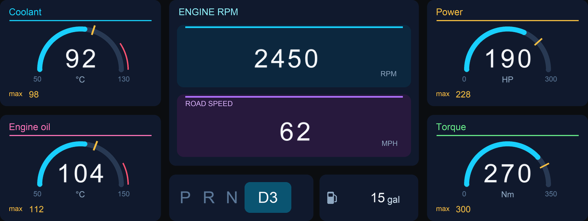

# BoostDeck CDS — BMW EntryNav2 / EntryEVO dashboard

> **Experimental, noncommercial, source-build project.** Integrates the original dashboard foundation with the later layout and US-units enhancements. This is **not** a precompiled car-ready download and is **not verified on other vehicles**. Never use it as a substitute for the instrument cluster.



*Actual dashboard artwork generated by the BoostDeck source for a 1280 × 480 display (1219 × 460 content area). The numerical readings in this image are illustrative samples, not live data. To regenerate from source on macOS, run `bash boostdeck.sh preview`; this generates `work/source/res/preview_en.png` without changing the car.*

BoostDeck CDS is a native, picture-model-based performance dashboard for BMW's **EntryNav2 (also called EntryEVO)** Linux ARMv7 head unit. It uses [MGD4096's Gauge App](https://github.com/MGD4096/Gauge-App-for-NBTEvo-and-EntryNav2) as the source foundation, retaining its PluginApp/CDS data collection, and applying the original blue-tile appearance, live RPM/MPH readings, and the later wide-screen/US-units improvements in **one fresh build**. This project is not affiliated with BMW.

**RPM and speed remain numeric**, as in the supplied source kits; the separately designed segmented M Sport bars are not included.

## Dashboard features

| Area | Behavior |
|---|---|
| Coolant | Live `engine.temperature` in °C or °F, max indicator |
| Engine oil | Live oil temperature in °C or °F, max indicator |
| Engine RPM | Live `engine.RPMSpeed`, 4-digit picture-number display |
| Road speed | Live `driving.speedActual`, converted from presumed km/h to MPH |
| Power | **Calculated** from torque and RPM, not ECU-reported actual horsepower; defaults to mechanical **HP**, starting scale **300 HP** |
| Torque | Live signed `engine.torque` in Nm; defaults to 350 Nm starting scale; negative values remain signed and do not create a positive arc |
| Gear | CDS `driving.gear` mapped using inherited upstream logic |
| Fuel | Estimated remaining volume, **US gal** default, rounded to a whole gallon; assumes CDS `tanklevel` is litres |
| Colors | Cyan/violet/magenta/green selectable themes; distinct colored card labels |
| Layout | **1060 × 400 design canvas**, rendered **1219 × 460 pixels** on a 1280 × 480 display, origin `(12,4)` |
| Data | Native CDS subscriptions; no laptop, ENET cable, or external relay required while running |

The inherited gauge arcs track recorded maxima with safeguards; numbers depend on the vehicle's CDS broadcasts. Some BMWs may not publish all properties. Values can be inaccurate or missing; no fault-code reading/clearing, coding, ECU flashing, boost gauge, oil pressure or AFR is included.

## Compatibility: read before installing

- **Supported build/install path:** EntryNav2 / EntryEVO **Linux ARMv7** head unit, **1280 × 480** iDrive display, root SSH access already lawfully available, matching car-provided frameworks, `ro` root mount at preflight.
- **Not supported by this installer:** **NBT Evo** (different **QNX** OS/binary ABI), NBT, CIC, ID7/MGU, iDrive without PluginApp support, 800 × 480 displays (upstream supports a different layout; *this* layout has not been adapted/tested there).
- **Not included:** root password, any exploit/unlock instructions, QNX toolchain, proprietary BMW `.so` libraries, or a prebuilt library.

[Compatibility details](docs/COMPATIBILITY.md) · [NBT Evo porting notes](docs/NBT_EVO_PORT.md). Upstream documents NBT Evo as a separate compilation and installation target; **do not rename an EntryNav2 archive and install it onto NBT Evo**.

## First-time setup (macOS regular Terminal)

1. Install [Docker Desktop](https://docs.docker.com/desktop/setup/install/mac-install/), Git, Python 3 with `venv`, and Apple Command Line Tools (`xcode-select --install`). Connect ENET to an **already SSH-accessible, compatible** head unit. Read [INSTALL.md](docs/INSTALL.md).
2. Unzip this project, open a **regular Mac Terminal** in its folder (not an SSH shell inside the BMW).
3. Check your prerequisites:

   ```bash
   bash boostdeck.sh doctor
   ```

4. To copy required BMW framework libraries **from your own compatible car to your local Mac**, read-only:

   ```bash
   bash boostdeck.sh fetch-libs
   ```

   Or supply a folder holding the two exact EntryNav2 libraries with `--libs PATH`. **Do not upload these files to GitHub.**

5. One-step **fresh source build with all included features**:

   ```bash
   bash boostdeck.sh build
   ```

   The script clones a pinned upstream baseline (`899e337`) if necessary, creates a separate working tree, applies both source transformations once, fixes the upstream XML comment, generates resources, runs validators and a C++98 smoke test, cross-compiles using Docker, validates the built ARM archive, and prints the output path.

6. **Inspect before any car writes**. Generate/open only the preview, if desired:

   ```bash
   bash boostdeck.sh preview
   ```

7. With car parked, ignition stable and the root filesystem **already read-only**, run:

   ```bash
   bash boostdeck.sh status
   bash boostdeck.sh install
   ```

   The installer validates the archive, checks target ABI/path and ID collisions, backs up an existing BoostDeckCDS to `work/backups/` before upgrades, requires the exact phrase `INSTALL BOOSTDECK`, stages and verifies the payload in `/tmp`, temporarily remounts `/` read-write, swaps one plugin directory, and remounts it read-only. **No automatic restart, deletion of GaugeApp, or removal of original BoostDeck.**

8. Perform **one normal controlled iDrive restart** only when safe, confirm the menu item appears and real data updates, and verify RPM/MPH/temperature with the BMW instrument cluster or a trusted scanner.

## Recovery

```bash
bash boostdeck.sh status
bash boostdeck.sh disable
bash boostdeck.sh enable    # only after verifying the cause of trouble is resolved
bash boostdeck.sh restore work/backups/BoostDeckCDS-YYYYMMDD-HHMMSS.tar
```

`disable` sets the writable data partition's `app.disable` flag, which takes effect when the plugin next starts. `restore` requires a valid local backup, safe read-only preflight, and a separate confirmation. If SSH is unavailable, the unit is reboot-looping, or root cannot return read-only, **do not repeatedly force restarts**. See [RECOVERY.md](docs/RECOVERY.md).

## Existing prebuilt workspace / network unavailable

If GitHub cloning is unavailable or you have a genuine untouched upstream checkout, build from it:

```bash
bash boostdeck.sh build --source "$HOME/path/to/Gauge-App-for-NBTEvo-and-EntryNav2" --libs "$HOME/path/to/Entry_Evo_libs"
```

A modified BoostDeckCDS `make_db.py` is **not** an unpatched source checkout. Anchor checks fail closed on unexpected versions. Before changing the pinned upstream revision, review both patch scripts and rerun tests. Do not remove validation asserts just to force a build.

## Repository structure

```text
boostdeck.sh                     Mac build/install/status/restore commands
scripts/remote_entrynav2.sh     Checked remote helper (POSIX sh)
tools/patch_source.py        Original dashboard transformation
tools/patch_features.py     Fuel/HP/Nm/wide-layout transformation
tools/fix_generator_xml.py     Upstream invalid XML-comment fix
tools/validate_*.py            Source, package, and backup validation
tests/                          Host-side unit tests and numeric C++ smoke test
docs/                           Setup, compatibility, and recovery guides
assets/preview_en.png        Generated dashboard screenshot (sample data; not live telemetry)
```

## Security and release integrity

The installer never requests or embeds a root password, disables SSH host-key validation, or modifies ECU firmware/coding. It touches only `Plugins/BoostDeckCDS` on the system partition, and the optional data-partition `app.disable` flag. **Running arbitrary installation scripts with head-unit root privileges still carries material risk of making the HMI unusable.** Review all scripts and keep backups off the car. This is not automotive safety instrumentation.

This repo is **source/build tooling**, not a downloadable binary release. A GitHub Action checks shell syntax, Python regressions and package safety offline; CI does **not** prove ARM linking or on-car operation because it cannot access BMW libraries or the real HMI. See [RELEASE_CHECKLIST.md](docs/RELEASE_CHECKLIST.md) before advertising a public release as tested.

## Origin, licensing, and credits

- Base: [MGD4096/Gauge-App-for-NBTEvo-and-EntryNav2](https://github.com/MGD4096/Gauge-App-for-NBTEvo-and-EntryNav2), revision `899e337`, based in part on NbtAad / entry-aad.
- The underlying Gauge App code follows **PolyForm Noncommercial 1.0.0**; preserve notices/headers and ensure any downstream distribution and use are compatible. **This is for noncommercial use only**, not an unrestricted MIT/GPL rewrite.
- The original BoostDeck by [CallMeLewis/EntryNav-Apps](https://github.com/CallMeLewis/EntryNav-Apps) is a separate project; no proprietary parts of that application are included.
- BMW and iDrive are trademarks of BMW AG; this software is not endorsed by BMW.

See [NOTICE.md](NOTICE.md) for attribution and licensing notes. For repository publishing, read [PUBLISH_GITHUB.md](docs/PUBLISH_GITHUB.md).